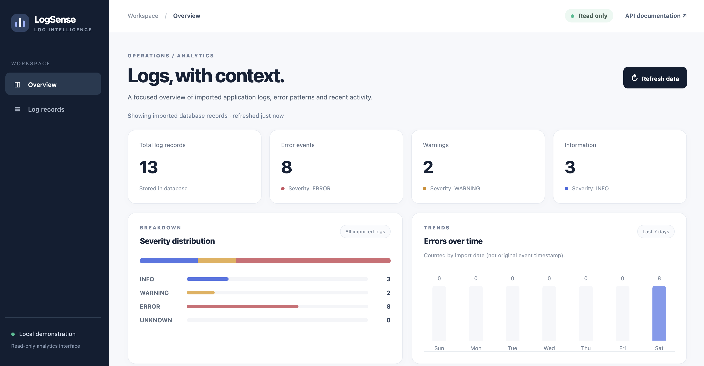

# LogSense / ログセンス
[日本語](#日本語)

**A focused log intelligence and analysis portfolio project.** LogSense imports plain-text application logs into PostgreSQL, exposes analytics with FastAPI, and provides a small local read-only dashboard for the latest error patterns and stored records.

**Status:** Maintenance. Finalisation was completed on 10 October 2026. The dashboard, repeat-import protection, automated tests, and Docker/PostgreSQL integration checks are complete. New work is limited to bug fixes, dependency/security updates, test reliability, and documentation. See [maintenance document](docs/maintenance.md) and [final verification](docs/final-verification.md).

## Features

- Import a local log file into PostgreSQL using SQLAlchemy.
- Prevent repeat imports while preserving genuine repeated events.
- View stored records and analytics in a read-only dashboard.
- Filter recent logs by search term and severity.
- Use FastAPI endpoints for stored logs, sample-file analytics, and reports.
- Run the API and PostgreSQL locally with Docker Compose..

## Technology stack

| Layer | Technology |
| --- | --- |
| Backend | Python, FastAPI, SQLAlchemy |
| Database | PostgreSQL 16; SQLite for backend tests |
| Dashboard | HTML, CSS, JavaScript |
| Containers | Docker, Docker Compose |
| Testing and CI | pytest, GitHub Actions, HTTP smoke tests |

## Run locally

Copy the example environment file:

    cp .env.example .env

Set your own `POSTGRES_PASSWORD` in `.env`, then run:

    docker compose up --build -d

    curl -X POST http://localhost:8002/logs/import

Open the dashboard at [http://localhost:8002/dashboard](http://localhost:8002/dashboard) or the API documentation at [http://localhost:8002/docs](http://localhost:8002/docs).

Importing the same file again returns `imported_count: 0`:

    curl -X POST http://localhost:8002/logs/import

Fetch the newest 20 error records:

    curl 'http://localhost:8002/logs/stored?severity=ERROR&limit=20'

Stop the services while preserving the database volume:

    docker compose down

The dashboard displays imported database records. The `/logs/summary` and `/logs/live` endpoints read directly from the sample file. Because source records do not contain event timestamps, dashboard dates represent UTC import time.

## Verify

Install the application and test dependencies:

    python -m pip install -r requirements.txt -r requirements-dev.txt
    python -m pytest -q

Backend CI runs the automated tests. Docker CI builds and starts the API and PostgreSQL services, checks the dashboard and API, and verifies repeat-import behaviour.

The dashboard shows imported **database** records; `/logs/summary` and `/logs/live` still read the sample file directly. Source records lack real event timestamps, so the dashboard labels dates as UTC **import time**.

## Automated verification

Install the existing app requirements plus testing dependencies, then run:

```bash
python -m pip install -r requirements.txt -r requirements-dev.txt
python -m pytest -q
```

The backend workflow runs actual tests rather than silently skipping them. Docker CI builds and starts the API + PostgreSQL stack, checks the dashboard and API, and verifies repeated imports.

## Architecture

```text
sample_logs/server.log
         |
         v
   POST /logs/import --> FastAPI --> SQLAlchemy --> PostgreSQL
                                |                   |
                                |       GET summary / records
                                v                   |
                         /dashboard <---------------+
```

## Project status and limitations

LogSense is a single-file, trusted-local portfolio project—not a production log-ingestion service. It does not include concurrent ingestion, log rotation, true event timestamps, authentication, multi-tenancy, or database backup and recovery. Do not expose its import or delete endpoints publicly without adding appropriate authentication and access controls. Persistent container storage is not a database backup.

## Documentation

For more context see [architecture](docs/architecture.md), [dashboard](docs/dashboard.md), [development notes](docs/development-notes.md), [API examples](docs/api-examples.md), and the [final verification checklist](docs/final-verification.md).

## Screenshots



## License

See [LICENSE](LICENSE).

## 日本語

[English](#logsense-ログセンス)

LogSenseは、テキスト形式のアプリケーションログをPostgreSQLに取り込み、FastAPIで分析データを提供するログ分析プロジェクトです。保存されたログや最近のエラーパターンを確認できる、読み取り専用のダッシュボードを備えています。

**状態：保守・メンテナンス中。** 2026年10月10日に最終整備を完了しました。ダッシュボード、重複インポート防止、自動テスト、DockerとPostgreSQLの連携確認が完了しています。ホストされたライブデモはありません。Docker Composeを使ってローカルで実行できます。

### 主な機能

- SQLAlchemyを使って、ローカルのログファイルをPostgreSQLに取り込む。
- 同じファイルの重複インポートを防ぎ、正当な重複イベントは保持する。
- 保存されたログと分析結果を読み取り専用ダッシュボードで表示する。
- 検索語や重要度で最近のログを絞り込む。
- 保存ログ、サンプルファイルの分析、レポート用のFastAPIエンドポイントを提供する。
- Docker ComposeでAPIとPostgreSQLをローカル実行する。

### 技術スタック

| 分野 | 技術 |
| --- | --- |
| バックエンド | Python、FastAPI、SQLAlchemy |
| データベース | PostgreSQL 16、バックエンドテストではSQLite |
| ダッシュボード | HTML、CSS、JavaScript |
| コンテナ | Docker、Docker Compose |
| テスト・CI | pytest、GitHub Actions、HTTPスモークテスト |

### ローカルで実行する

例の環境設定ファイルをコピーします。

    cp .env.example .env

`.env`に独自の`POSTGRES_PASSWORD`を設定し、次のコマンドを実行します。

    docker compose up --build -d

    curl -X POST http://localhost:8002/logs/import

ダッシュボードは[http://localhost:8002/dashboard](http://localhost:8002/dashboard)、APIドキュメントは[http://localhost:8002/docs](http://localhost:8002/docs)で確認できます。

同じファイルを再度インポートすると、`imported_count: 0`が返されます。

    curl -X POST http://localhost:8002/logs/import

最新のERRORログを20件取得します。

    curl 'http://localhost:8002/logs/stored?severity=ERROR&limit=20'

データベースのボリュームを保持したままサービスを停止します。

    docker compose down

ダッシュボードにはデータベースに取り込まれたログが表示されます。`/logs/summary`と`/logs/live`はサンプルファイルを直接読み込みます。元のログにイベント日時がないため、ダッシュボードの日付はUTCでのインポート時刻です。

### テスト

アプリケーションとテストの依存関係をインストールします。

    python -m pip install -r requirements.txt -r requirements-dev.txt

    python -m pytest -q

Backend CIは自動テストを実行します。Docker CIはAPIとPostgreSQLをビルド・起動し、ダッシュボード、API、重複インポート防止を確認します。

### アーキテクチャ

    sample_logs/server.log

            |

            v

    POST /logs/import --> FastAPI --> SQLAlchemy --> PostgreSQL

                             ^                         |

                             +----- /dashboard <-------+

### 状態と制限事項

LogSenseは、信頼できるローカル環境での利用を想定した、単一ファイルのポートフォリオプロジェクトです。本番向けのログ収集サービスではありません。同時インポート、ログローテーション、実際のイベント日時、認証、マルチテナント、データベースのバックアップと復旧には対応していません。適切な認証とアクセス制御を追加せずに、インポートまたは削除エンドポイントを公開しないでください。コンテナの永続ストレージはデータベースのバックアップではありません。

### ドキュメント

詳細については、[アーキテクチャ](docs/architecture.md)、[ダッシュボード](docs/dashboard.md)、[開発ノート](docs/development-notes.md)、[API の例](docs/api-examples.md)、および [最終検証チェックリスト](docs/final-verification.md) を参照してください。

## スクリーンショット


## ライセンス

詳細は[LICENSE](LICENSE)をご覧ください。
