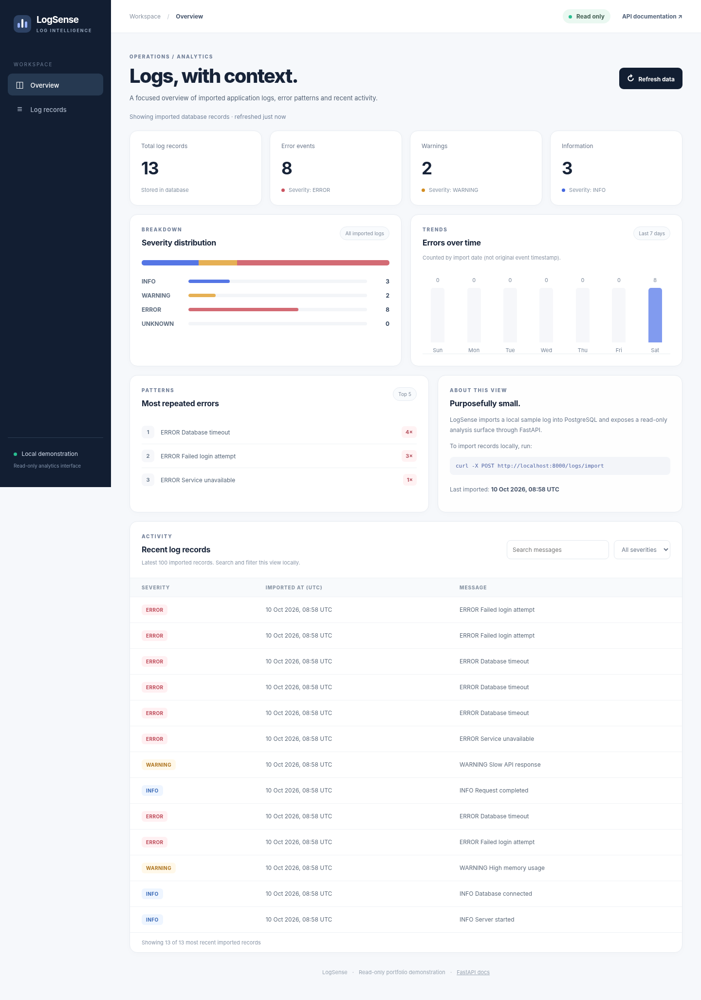

# LogSense / ログセンス

**A focused log intelligence and analysis portfolio project.** LogSense imports plain-text application logs into PostgreSQL, exposes analytics with FastAPI, and provides a small read-only dashboard for the latest error patterns and stored records.

アプリケーションログを PostgreSQL に保存(ほぞん)し、FastAPI と読(よ)み取(と)り専用(せんよう)ダッシュボードで分析(ぶんせき)する、小規模(しょうきぼ)なポートフォリオプロジェクトです。

## Current milestone

**Finalisation — ready for verification.** The read-only dashboard, repeat-import protection, automated regression tests, CI improvements and documentation are included in this change set.

### Features

- Import one local log file into PostgreSQL with SQLAlchemy.
- Sequential repeat-import protection that preserves genuine repeated events.
- Database-backed severity distribution, top error messages, and last seven days of errors by **UTC import date**.
- FastAPI routes for sample-file analytics, stored logs, and reporting.
- Read-only browser dashboard with recent log search and severity filtering.
- Docker Compose environment with persistent PostgreSQL storage.
- Backend tests (isolated SQLite) and Docker Compose smoke verification in GitHub Actions.

## Technology stack

| Layer | Technology |
| --- | --- |
| Backend | Python, FastAPI, SQLAlchemy |
| Database | PostgreSQL 16 (Docker), SQLite (tests) |
| Frontend | Native HTML, CSS, JavaScript |
| Container runtime | Docker and Docker Compose |
| CI | GitHub Actions, pytest, HTTP smoke tests |

## Quick start (local Docker)

```bash
cp .env.example .env
# Edit .env and set your own POSTGRES_PASSWORD

docker compose up --build -d
curl -X POST http://localhost:8000/logs/import
```

Open:

- Dashboard: **http://localhost:8000/dashboard**
- API docs: **http://localhost:8000/docs**
- DB-backed analytics JSON: **http://localhost:8000/logs/dashboard-summary**

```bash
# Repeating the same import returns imported_count: 0
curl -X POST http://localhost:8000/logs/import

# Fetch the newest 20 ERROR records
curl 'http://localhost:8000/logs/stored?severity=ERROR&limit=20'

# Keep persisted volume when stopping
docker compose down
```

The dashboard shows imported **database** records; `/logs/summary` and `/logs/live` still read the sample file directly. Source records lack real event timestamps, so the dashboard labels dates as UTC **import time**.

## Automated verification

Install the existing app requirements plus testing dependencies, then run:

```bash
python -m pip install -r requirements.txt -r requirements-dev.txt
python -m pytest -q
```

The backend workflow runs actual tests rather than silently skipping them. Docker CI builds and starts the API + PostgreSQL stack, checks the dashboard and API, and verifies repeated imports.

## API reference

| Method | Path | Purpose |
| --- | --- | --- |
| GET | `/` | API root |
| GET | `/dashboard` | Read-only browser UI |
| GET | `/logs/dashboard-summary` | Aggregate stored records |
| GET | `/logs/stored?limit=100&severity=ERROR` | Stored logs with optional filter and bounded limit |
| POST | `/logs/import` | Import configured sample file |
| GET | `/logs/summary` | Sample-file severity summary |
| GET | `/logs/errors` | Sample-file errors |
| GET | `/logs/report` | Generated local report text |
| GET | `/logs/live` | Latest sample-file records |
| DELETE | `/logs/stored` | Clear stored records (development only) |

## Architecture

```text
sample_logs/server.log
         |
         v
   POST /logs/import --> FastAPI --> SQLAlchemy --> PostgreSQL
                                |                   |
                                |       GET summary / records
                                v                   |
                         /dashboard <---------------+
```

For more context see [architecture](docs/architecture.md), [dashboard](docs/dashboard.md), [development notes](docs/development-notes.md), [API examples](docs/api-examples.md), and the [final verification checklist](docs/final-verification.md).

## Limitations / future Kansoku Cloud work

LogSense is a **single-file, trusted-local portfolio demo**, not production-grade ingestion. Concurrent imports, log rotation, true event timestamps, cloud deployment, auth, multi-tenancy, backup and recovery are not included. Never expose the existing import/delete API publicly without authentication and access controls. Container persistence is not a database backup.

Future distributed ingestion/ClickHouse/OpenTelemetry/AWS/Terraform work will evolve separately under **Kansoku Cloud**.

## Screenshots



## License

See [LICENSE](LICENSE).
